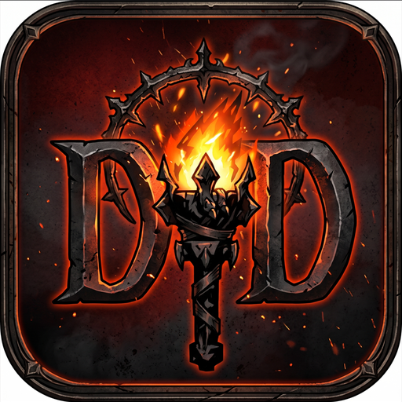

<p align="center"></p>

# Darkest Dungeon Porter

Runs your own GOG or Steam copy of **Darkest Dungeon®** (the Linux version) natively on Android phones. There is no Windows emulator and no root. Box64 translates the game's x86_64 code to ARM64, and gl4es turns its desktop OpenGL into OpenGL ES.

> **No game files are included.** You need to own Darkest Dungeon on GOG or Steam. The app imports the game from GOG's Linux installer, or from a zip of your Steam copy, which you make yourself.
> The app runs the game's DRM-free Linux build, which both stores ship; Steam doesn't need to run on the phone.
> This project is not affiliated with or endorsed by Red Hook Studios, GOG or Valve. Darkest Dungeon is a trademark of Red Hook Studios Inc.

## Requirements
- Android 12 or newer, 64-bit ARM (arm64-v8a).
- A GPU with OpenGL ES 2 and `GL_OES_texture_3D` (the game's colour grading needs it).
- About 4.5 GB of free storage for the import: the installer (about 1.9 GB) or the Steam zip (about 2.1 GB, more with DLCs), plus 2.5 GB for the game (the import doesn't start with less free). Afterwards you can delete the installer or zip, and the game uses about 2.5 GB.
- One of:
  - GOG's **Linux** installer of Darkest Dungeon (`darkest_dungeon_…_linux_….sh`). Tested with build 27988.
  - A Steam copy, packed on a Windows PC by `get-steam-game.bat` (below). Tested with build 28212.

**Tested on:**

| Device | GPU | Android | Result |
|---|---|---|---|
| OnePlus 5 | Adreno 540 | LineageOS 22 (Android 15) | Title and dungeon at 1080p / 60 FPS |
| Samsung Galaxy A34 | Mali-G68 | Android 16 | Title, new campaign and first dungeon at 1080p / 60 FPS; dungeon also at 1440p and 4K, at 60 and 30 FPS |

Other devices may work. Reports are welcome.

## Install and first run
1. Install the APK (from the [Releases page](https://github.com/KatayR/darkest-dungeon-porter/releases), or built yourself as described below).
2. Get the game onto the phone:
   - **From GOG:**
     1. Log in to your GOG account on gog.com.
     2. Download the Linux installer of the game: https://www.gog.com/downloads/darkest_dungeon/en3installer0
        - The link only works while you are logged in to an account that owns Darkest Dungeon.
        - The file is called `darkest_dungeon_…_linux_….sh` and is about 1.9 GB.
   - **From Steam** (needs a Windows 10 or 11 PC with Steam):
     1. Start Steam and log in to the account that owns Darkest Dungeon.
     2. Download `get-steam-game.bat` from the [Releases page](https://github.com/KatayR/darkest-dungeon-porter/releases) (or [from the repo](port/steam/get-steam-game.bat)) and double-click it.
        - It asks the running Steam to download the game's Linux files (and the DLCs you own) to Steam's `steamapps\content` folder, then packs what the phone needs into `darkest-dungeon-steam.zip` next to the bat.
     3. Copy `darkest-dungeon-steam.zip` to the phone.
3. Open **Darkest Dungeon Porter** and tap **Import game**, then pick the installer or the zip.
   - The app unpacks only the game data and converts six shaders to OpenGL ES.
   - You can delete the installer or zip afterwards.
4. Choose a resolution (4K, 1440p, 1080p, 900p, 720p or 540p) and a frame rate (60/30/20/15), then tap **Play**. Lower settings save battery; resolutions above the screen's own are scaled down, so they look slightly sharper but cost much more GPU time.

Saves are kept in the app's private storage, so uninstalling the app deletes them.

## Controls
The touch screen works like a laptop trackpad:
- **One finger** moves the cursor.
- **Tap** to left-click.
- **Two-finger tap** to right-click.
- **Tap, then touch again and hold** to drag.
- **Back** opens the game's Escape menu.

When the game asks for text (naming the hamlet, renaming a hero), the on-screen keyboard opens and the game slides up so the field stays above it. Enter confirms. If Back hid the keyboard, a tap brings it back.

## Known limitations
- The frame rates are exact only on 60 Hz and 120 Hz screens. Each game frame stays up for a whole number of refreshes (the refresh rate divided by the chosen rate, rounded), so on a 90 Hz screen "60" gives 45 FPS. The refresh rate is read once, when the game starts. Only 60 Hz has been tested.
- Stay in the app while it imports the game. Android may stop the app in the background; an unfinished import is thrown away, and the next one starts over.
- Release builds are not debuggable, so the game's `dd.log` can't be read from them (see the notes under Building).

## How it works
The app runs as two processes:

```
app process (Java + libddview.so)                     game process (libddhost.so, started by the app)
  launch / import screens                               Box64 as a shared library, built against Android's libc
  shows the game's frames, draws the cursor   <-- frames + fences --   x86_64 darkest.bin, FMOD, libstdc++
  touch -> trackpad, Back -> Escape           -- input -->             libddglue.so  (stands in for SDL2: GLES context, frames, input;
                                                                                        the rest goes to the real libSDL2.so)
                                                                         libGL.so      (gl4es: OpenGL 2.1 -> GLES 2)
                                                                         libddaudio.so (stands in for ALSA: FMOD's output -> AAudio)
```

- **Box64 on Android's libc:** Box64's Android build only runs Android x86_64 programs, and the game is a Linux (glibc) program. `port/apk/patches/box64-glibc-on-bionic.patch` adds the missing glibc layer on top of Android's bionic libc: program start-up, ctype and locale tables, `sysconf`/`nl_langinfo`/`glob` constant translation, and more. No glibc or Linux root filesystem is needed.
- **gl4es patches:**
  - real 3D textures for the colour-lookup tables;
  - client-array draws that pass only the vertex range they use, which takes 1080p from about 45 to 60 FPS on Adreno;
  - a fix for a scissor/viewport cache bug.
- **Frames:** the game renders into shared hardware buffers. The app shows them, and native fences keep the two processes in step without `glFinish`.

The full development log, including measurements and dead ends, is in [`notes/todo.md`](notes/todo.md). Lessons learned are in [`notes/lessons.md`](notes/lessons.md). [`port/phone/`](port/phone) holds the first approach: a rooted phone with a Debian chroot and VirGL.

## Building
The build scripts are tested on **Windows with Git Bash**. Linux and macOS hosts are untested, because the scripts call Windows tools such as `cygpath` and `tar.exe`.

**Needed:**
- Android SDK with NDK 27.1.12297006, CMake 3.22.1 and 4.1.2;
- JDK 17 or newer (Android Studio's bundled JBR works);
- git, curl and Python 3.

`ANDROID_SDK` sets the SDK location (default `%LOCALAPPDATA%\Android\Sdk`), and `JAVA_HOME` the JDK (default Android Studio's JBR, `C:\Program Files\Android\Android Studio\jbr`).

```bash
port/apk/build-natives.sh          # fetches pinned Box64, gl4es and SDL2, applies port/apk/patches, builds them
port/apk/build-apk.sh              # debug APK
port/apk/build-apk.sh release      # release APK (signing below)
```

- Sources and build output go to `$DD_BUILD` (default `C:\dd-build`), outside the repo.
- The APK lands in `$DD_BUILD/gradle/app/outputs/apk/<type>/`.

**Signing a release build:** `DD_KEYSTORE`, `DD_KEYSTORE_PASSWORD` and `DD_KEY_ALIAS` select the key (plus `DD_KEY_PASSWORD` if the key has its own password). Without them the release APK is unsigned; sign it with `apksigner` using your own key.

**Notes:**
- Release builds are not debuggable.
- For bug reports: the app, gl4es and the glue libraries log to logcat (`adb logcat -s DDActivity ddview ddglue ddaudio LIBGL`), including the frame rate once a second. The game process's own output (Box64 and the game) goes to `dd.log` in the app's private files folder, which only a debug build can read: `adb shell run-as org.ddport.darkest cat files/dd.log`.
- The launcher icon is generated by `port/apk/icon/make-icon.py`.

## Credits and licence
- [Box64](https://github.com/ptitSeb/box64) and [gl4es](https://github.com/ptitSeb/gl4es) by ptitSeb and contributors, [SDL](https://www.libsdl.org/), and the GCC runtime libraries from Debian.
  - Their licences are in [`THIRD_PARTY_NOTICES.txt`](port/apk/app/src/main/assets/THIRD_PARTY_NOTICES.txt), which is also shipped inside the APK.
  - The Gradle wrapper is Apache-2.0.
- The port's own code is under the [MIT licence](LICENSE). The patches are under the licence of the project they patch.
